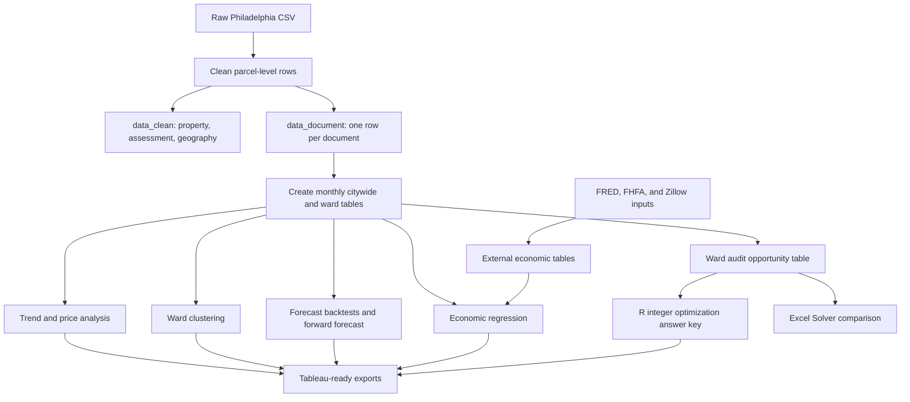

# Philadelphia Real Estate Transfers Project

## Technical plan and code guide

**Client:** City of Philadelphia  
**Course:** BSAN 710  
**Analysis period:** January 2000 through July 2026  
**Main question:** How have property sales and new mortgage activity changed
across Philadelphia, how do those changes relate to the wider housing market,
and how could the City use the findings to allocate limited review resources?

This document explains the project in plain language while showing how each
part connects to the R code. It separates completed work from remaining work
so readers are not asked to distinguish between a proposal and an implemented
method.

Status labels used below:

- **Complete:** coded, run, and checked.
- **Needs validation:** coded, but an assumption or external deliverable still
  needs confirmation.
- **Not yet built:** intentionally left for the next project stage.

---

## 1. What the project delivers

The project follows four analytical stages:

1. **Descriptive analytics - what happened?**  
   Clean the transfer records and describe deed, mortgage, price, and ward
   patterns over time.
2. **Predictive analytics - what is associated with the changes, and how
   unusual were recent periods?**  
   Compare forecasting models, measure deviations during major disruptions,
   and estimate associations with mortgage rates, home prices, and recessions.
3. **Segmentation - where did different patterns occur?**  
   Group wards with similar long-term activity and price trajectories.
4. **Prescriptive analytics - what action could the City take?**  
   Allocate a limited number of review or audit opportunities across wards
   using an integer optimization model.

The final R pipeline produces documented CSV files for Tableau, model-quality
tables, an optimization answer key, and a source catalog.

---

## 2. Data sources

### 2.1 Philadelphia Real Estate Transfer records

**File:** `data/raw/rtt_summary.csv`  
**Source:** [OpenDataPhilly Real Estate Transfers](https://opendataphilly.org/datasets/real-estate-transfers/)  
**Raw size:** 5,168,394 rows and 47 columns

The most important point about the raw file is its **record grain**:

> A raw row is one legal document associated with one property parcel. It is
> not necessarily one independent transaction.

A legal document can cover several parcels, so the same `document_id` can
appear on multiple rows. Counting raw rows would therefore overstate the
number of transactions. The code therefore keeps two explicit grains:
`data_clean` has one row per `record_id`, while the derived `data_document`
table has one row per `document_id`. Analyses select the table that matches the
question rather than deleting valid parcel rows.

Important raw fields include:

| Field | Plain-language meaning | How the code uses it |
|---|---|---|
| `document_id` | Identifier for the legal filing | Defines one transaction for counting |
| `document_type` | Type of filing, such as deed or mortgage | Converted into analysis categories |
| `recording_date` | Date the filing was recorded | Main date; `display_date` is the fallback |
| `total_consideration` | Reported transaction consideration | Used for deed-price analysis |
| `adjusted_*` fields | Corrected financial values | Preferred when available |
| `ward` | Philadelphia ward number | Used for geographic summaries and optimization |
| `zip_code` | ZIP or concatenated ZIP+4 value | Standardized to the first five digits |
| `shape` | Point geometry in the source coordinate system | Retained, but not yet used for the final map |

### 2.2 External economic and peer-market data

The script `R/econ_peer_etl.R` prepares:

- the 30-year mortgage rate (`MORTGAGE30US`) from FRED;
- the NBER recession indicator (`USREC`) from FRED;
- the Philadelphia FHFA home-price index (`ATNHPIUS37964Q`);
- quarterly FHFA indexes for Baltimore, Pittsburgh, Cleveland, and Detroit;
- optional monthly Zillow ZHVI and sales-count data when the public files are
  available.

Every external field, frequency, transformation, and source URL is recorded
in `external_data/source_catalog.csv` and copied to the Tableau output folder.

---

## 3. Data-quality rules and their purpose

These are analytical decisions, not arbitrary code cleanup.

| Rule | Reason |
|---|---|
| Keep dates from `2000-01-01` through `2026-07-31` | Earlier records are extremely sparse and include corrupted years; July is the latest complete 2026 month approved by the group, while August is partial |
| Prefer adjusted financial fields | They contain source-provided corrections |
| Use `recording_date`, then fall back to `display_date` | Provides one consistent transaction date |
| Count `document_id`, not raw rows | Prevents multi-parcel documents from being counted more than once |
| Analyze mortgage activity as counts | Mortgage dollar fields are missing for most mortgage records |
| Define a nominal deed as reported consideration less than or equal to $100 | Separates low-consideration transfers from market-priced transfers |
| Keep missing deed consideration in a separate flag | Missing does not automatically mean nominal |
| Assign one primary ward when additive ward totals are required | Prevents a multi-ward document from increasing the citywide total |
| Complete every calendar month in the analysis period | Makes lags, year-over-year changes, and forecasting mathematically consistent |

Earlier snapshots exposed type-guessing problems in address fields: fractional
street-number values such as `1/2` and, in the current snapshot, 2,001 compass
values in `street_postdir` could be guessed as Boolean fields. The code now
imports both `address_low_frac` and `street_postdir` as text. The October 9,
2026 full source reread produces zero parsing problems.

---

## 4. Project files and responsibilities

| File or folder | Responsibility |
|---|---|
| `R/setup_project.R` | Checks for and installs the required R packages |
| `R/econ_peer_etl.R` | Downloads, caches, cleans, and documents external economic and peer data |
| `R/BSAN_Proj.R` | Runs Philadelphia cleaning, EDA, models, optimization, validation, and exports |
| `model_inputs/ward_solver_input.xlsx` | Excel Solver implementation and sensitivity workbook |
| `cache/` | Stores cleaned large R objects and parsing diagnostics |
| `external_data/` | Stores raw external downloads and cleaned external tables |
| `team_data/` | Stores parcel-level `data_clean`, document-level `data_document`, dictionaries, and build metadata |
| `tableau_data/` | Stores final dashboard-ready tables and their manifest |
| `docs/README_RUN_ORDER.md` | Gives the exact setup, refresh, and rerun instructions |

### Required R packages

The main analysis uses `tidyverse`, `lubridate`, `tsibble`, `feasts`,
`fabletools`, `fable`, `lpSolve`, and `readxl`.

---

## 5. Pipeline overview



In plain language: the code first creates trustworthy transaction records,
then summarizes them at the correct time and geographic levels. Those tables
feed the trend analysis, clustering, forecasting, regression, and optimization.
The final section writes small, clearly keyed files instead of one duplicated
wide table.

---

## 6. `R/BSAN_Proj.R` code walkthrough

### Section 1 - Load data and reuse the clean cache

**Status: Version 6 implemented and validated on October 9, 2026**

What the code does:

- creates the `cache`, `external_data`, and `tableau_data` folders;
- looks for `cache/philly_rtt_clean_v6.rds`;
- loads previously cleaned objects when the cache version matches;
- otherwise reads the large raw CSV with declared column types.

Why it matters: the source file is almost 2 GB. Reusing the cache makes normal
reruns much faster while the cache version protects against silently using old
cleaning rules.

Main objects loaded from or written to the cache:

- `parcel_clean`
- `transactions_by_doc`
- `document_ward_bridge`
- `transactions_by_doc_primary_ward`
- `cleaning_audit`
- the document-level sale-price outlier cutoff

### Sections 2 and 3 - Diagnose and clean the Philadelphia records

**Status: Version 6 implemented and validated on October 9, 2026**

What the code does:

1. removes rows explicitly marked as source discrepancies;
2. prefers adjusted financial values over original values;
3. creates one canonical transaction date;
4. keeps January 2000 through July 2026 and excludes partial August 2026;
5. creates five activity groups:
   - `sale_deed`
   - `new_mortgage`
   - `mortgage_lifecycle`
   - `other`
   - `unknown`
6. adds Sale, Loan, and Other transaction labels and identifies deed variants;
7. creates nominal-transfer and unknown-consideration indicators;
8. flags the upper 0.1% of eligible document-level sale prices;
9. retains every valid parcel record in the central cleaned table;
10. derives a separate one-row-per-document analytical table;
11. records conflicts instead of hiding them;
12. builds a document-to-ward bridge and a primary-ward table.

The validated version 6 build contains:

- 5,067,868 cleaned parcel-level rows;
- 4,401,686 unique document-level records;
- 35 parcel columns and 47 document columns;
- 16,203 raw source rows marked as discrepancies and excluded by the rule;
- an $11,152,916.98 document-level cutoff for the upper 0.1% sale-price flag.

The final handoff keeps both grains. This preserves property information while
the derived document table prevents double-counting in transaction analysis.

### Section 3B - Build the central team dataset

**Status: Version 5 implemented and validated on October 7, 2026**

The project now exports two related tables:

- `team_data/data_clean.csv.gz`: one row per `record_id`; this is the central
  cleaned parcel table for property, assessment, geography, and mapping work;
- `team_data/data_document.csv.gz`: one row per `document_id`; this is the
  derived table for transaction counts, recorded-tax totals, forecasting, and
  Tableau.

The parcel table keeps reported and adjusted monetary fields separate. The
document table sums adjusted parcel allocations when coverage is complete and
otherwise uses one consistent reported document value. Coverage, aggregation
method, and reconciliation-difference fields make the choice auditable.

Version 6 also removes explicit source-discrepancy rows, classifies every deed
variant, adds broad Sale/Loan/Other labels, and flags the upper 0.1% of eligible
document-level sale consideration. Outliers remain in activity counts but are
excluded from typical-price measures throughout the later analysis.

Each file has its own dictionary. `team_data/data_clean_metadata.csv` records
both grains and dimensions. The R Global Environment retains `data_clean` and
`data_document` so later sections can name the correct input explicitly.

### Section 4 - Build the monthly analysis table

**Status: Complete**

The code converts document-level activity into exactly one row per month from
January 2000 through July 2026: 319 months in total.

Main fields:

- number of deeds;
- number of nominal deeds;
- number of arms-length deeds;
- median arms-length deed price;
- recorded local transfer tax and missing-tax count;
- number of new mortgages.

Missing event counts become zero. Missing prices remain missing because zero
would incorrectly imply that a market sale occurred at a price of $0.

### Sections 5 through 8 - Descriptive analysis and ward patterns

**Status: Complete**

These sections provide the evidence needed before modeling:

- quick visual sanity checks;
- year-over-year deed and mortgage changes;
- seasonal-trend decomposition;
- deed-price distributions with nominal transfers excluded;
- ward missingness by activity type;
- ward-by-year and ward-by-month tables.

Section 8 also creates ward trajectory features by comparing an early period
(2000-2004) with a recent period (2021-2025). Features include:

- change in deed activity;
- change in typical arms-length price;
- recent mortgage-to-deed ratio;
- recent nominal-transfer share.

The standardized features are grouped with k-means. Candidate solutions from
two through six clusters are compared using average silhouette width instead
of selecting the number of clusters by eye. The current data select **two
ward clusters**.

Interpretation boundary: a cluster is a descriptive group of similar wards.
It does not prove that gentrification, policy, or any other cause produced the
pattern.

### Section 9 - Forecast backtests

**Status: Complete**

The code compares four models for deed and mortgage counts:

- naive;
- seasonal naive;
- exponential smoothing (`ETS`);
- autoregressive integrated moving average (`ARIMA`).

Three validation exercises answer different questions:

| Validation window | Training setup | Question answered |
|---|---|---|
| 2020-2025 | Train through 2019 | How unusual was the pandemic and post-pandemic period relative to the prior pattern? |
| 2008-2012 | Train through 2007 | How did the financial-crisis disruption compare? |
| 2023-2025 | Train only on 2015-2019 | Can a recent pre-pandemic regime still describe the higher-rate period? |

Models are ranked primarily by out-of-sample RMSE, with MAPE and residual
Ljung-Box tests shown as supporting diagnostics. The purpose of the backtests
is to quantify disruption, not to claim that a model could perfectly predict
an economic shock.

### Section 10 - Forward forecast for 2026-2028

**Status: Complete**

The best model from the primary validation is refitted using all observations
through December 2025 and projected 36 months forward. Tableau receives:

- a point forecast;
- 80% model-based prediction intervals;
- 95% model-based prediction intervals.

Because transaction counts cannot be negative, exported lower interval bounds
are limited to zero. The intervals express model uncertainty; they are not a
guarantee or a City budget commitment.

### Section 10B - Economic indicators, lags, and regression

**Status: Complete, with a modeling caveat**

The code joins monthly transaction activity to:

- the 30-year mortgage rate;
- Philadelphia home-price growth;
- the recession indicator.

It first scans several lags to show whether an indicator tends to lead or lag
activity. The documented regression then models the logarithm of monthly deed
or mortgage counts using:

- one-month autoregressive activity;
- the mortgage rate lagged three months;
- year-over-year Philadelphia HPI growth;
- the recession indicator;
- a time trend;
- calendar-month controls.

This is an **association model**, not a causal experiment. A coefficient does
not prove that changing the mortgage rate or HPI alone caused the transaction
change.

Current diagnostic note: the mortgage regression still shows residual
autocorrelation (`Ljung-Box p = 0.027`). Its coefficients should therefore be
described cautiously or the error structure should be improved before strong
inferential claims are made.

### Sections 11 and 12 - Prepare and solve the allocation model

**Status: Complete in R; operating assumptions need validation**

The decision question is:

> If the City can review no more than 1,000 nominal-transfer cases per year,
> how should those reviews be distributed across wards to maximize the
> potential transfer-tax value reviewed while maintaining minimum coverage?

For each ward, the code calculates:

- the recent annual number of nominal-transfer opportunities;
- the median recent arms-length price;
- a maximum feasible number of annual reviews;
- potential tax value per review.

The integer optimization is:

```text
Decision variable:
  audits_w = whole-number reviews assigned to ward w

Maximize:
  sum(value_per_audit_w * audits_w)

Subject to:
  audits_w <= recent annual opportunity in ward w
  audits_w >= 1 for each eligible ward
  sum(audits_w) <= 1,000
  audits_w is an integer
```

`lpSolve` provides an independent R answer key. The current valid R solution:

- allocates exactly 1,000 reviews across 66 eligible wards;
- has a modeled objective of approximately **$24.01 million in potential tax
  value reviewed per year**.

This is deliberately not labeled recovered revenue. The calculation uses the
4.578% combined transfer-tax rate and currently assumes a 100% recovery
probability because no validated recovery rate is available. Actual staffing
capacity and historical recovery probability must replace those assumptions
before policy use.

### Section 13 - Check the Excel Solver result

**Status: Needs validation**

The code reads either `ward_solver_output_excel.csv` or the decision values in
`model_inputs/ward_solver_input.xlsx`. It checks:

- whether every ward has an allocation;
- the one-review minimum;
- each ward's opportunity cap;
- integer allocations;
- the 1,000-review total capacity.

The workbook currently retains a 4,000-review sensitivity solution. That is
not feasible for the active 1,000-review case. The R pipeline therefore warns
the user and exports the valid R answer key instead of silently using the
infeasible workbook result.

Required next step: rerun Excel Solver with the 1,000-review constraint, save
the workbook, and confirm that its allocation and objective match the R answer
key.

### Section 14 - Export Tableau-ready files

**Status: Complete**

The code writes one file per analytical grain. This prevents many-to-many
joins and duplicated totals in Tableau. Before writing, it checks that the
expected keys are unique.

---

## 7. Tableau output model

The authoritative list is `tableau_data/README_export_manifest.csv`.

| File | One row represents | Main key | Use in Tableau |
|---|---|---|---|
| `fact_monthly_citywide.csv` | One citywide month | `yr_mo` | Actual activity, YoY changes, disruption deviations, and forecasts |
| `fact_monthly_geo.csv` | One ward in one month | `yr_mo + geo_id` | Ward trends and cluster filtering |
| `dim_geo.csv` | One ward | `geo_id` | Ward attributes, trajectory features, and cluster labels |
| `dim_econ_indicators.csv` | One month | `yr_mo` | Mortgage rate, Philadelphia HPI, and recession context |
| `fact_quarterly_peer_hpi.csv` | One city in one quarter | `quarter + city` | Consistent FHFA peer-city price comparison |
| `fact_monthly_peer_cities.csv` | One city, metric, and month | `yr_mo + city + metric` | Optional Zillow comparison |
| `optimization_results.csv` | One ward | `geo_id` | Recommended reviews and objective contribution |
| `model_forecast_accuracy.csv` | One model in one validation exercise | `holdout + outcome + .model` | Model-comparison evidence |
| `model_regression_coefficients.csv` | One regression coefficient | `outcome + term` | Economic-association results |
| `model_regression_diagnostics.csv` | One modeled outcome | `outcome` | Fit and residual checks |
| `model_cluster_validation.csv` | One candidate cluster count | `k` | Evidence for the selected number of clusters |
| `source_catalog.csv` | One external field | `output_field` | Data lineage and citations |

Tableau should relate the files using their stated keys. They should not be
physically joined into one large table, because that would repeat citywide,
ward, and peer-city values at incompatible grains.

---

## 8. Quality controls already in the code

The pipeline stops or warns when an important assumption fails.

| Check | What it protects against |
|---|---|
| Unique `record_id` in `data_clean` | Accidental removal or duplication of parcel records |
| Unique `document_id` in `data_document` | Double-counted multi-parcel transactions |
| Separate schema checks for both files | Undocumented columns or a silent change of analytical grain |
| Exactly 312 analysis months | Broken lags or irregular forecasting intervals |
| Unique Tableau keys | Duplicated dashboard totals |
| Nonnegative exported forecast bounds | Impossible negative count displays |
| Candidate-model holdout scoring | Selecting a model only because it fits historical training data |
| Residual diagnostics | Treating patterned errors as random noise |
| Silhouette comparison | Arbitrary cluster-count selection |
| Integer Solver variables | Fractional reviews or audits |
| Excel feasibility check | Exporting a saved sensitivity case as the active recommendation |
| External source catalog | Losing the lineage of economic fields |

Current end-to-end checks passed:

- final optimization export: 66 wards, 1,000 total reviews, approximately
  $24.01 million modeled objective;
- citywide monthly file: 348 rows, consisting of 319 historical months and
  29 forecast months, with unique month keys;
- ward-month file: 21,054 rows with unique month-and-ward keys;
- current cached economic file: 312 months through December 2025 with unique
  month keys; refresh `R/econ_peer_etl.R` separately before interpreting 2026
  economic relationships;
- corrected source import: zero parsing problems;
- version 6 handoff: 5,067,868 parcel records and 4,401,686 document records,
  with exact dimensions and cleaning parameters written to the metadata file.

---

## 9. What the results can and cannot support

### Supported statements

- how recorded deed and new-mortgage counts changed from 2000 through July
  2026, with 2026 labeled year-to-date;
- how large the 2008-2012 and 2020-2025 deviations were relative to fitted
  historical baselines;
- which wards have similar measured trajectories;
- how transaction activity is conditionally associated with the included
  economic indicators;
- the mathematically optimal allocation under the stated review-capacity,
  opportunity, equity-floor, and value assumptions.

### Statements to avoid

- treating parcel rows as independent transactions;
- interpreting mortgage consideration fields as reliable loan balances;
- saying the regressions prove causation;
- labeling ward clusters as demographic change without demographic data;
- calling the optimization objective guaranteed recovered revenue;
- presenting forecast intervals as certainty;
- treating quarterly FHFA observations repeated for a monthly join as new
  monthly measurements.

---

## 10. Remaining work

### Required for the final deliverable

1. **Rerun and save Excel Solver:** use the active 1,000-review constraint and
   confirm agreement with the R answer key.
2. **Add ward boundary geometry:** needed for a true filled ward map in
   Tableau. The current output contains ward identifiers and metrics but not
   polygon boundaries.
3. **Build the Tableau workbook:** trend overview, ward view, peer comparison,
   model validation, and allocation recommendation.
4. **Complete the literature review:** add specific sources on Philadelphia
   housing change, the 2008 and pandemic housing cycles, transfer-tax revenue,
   and assessment or audit policy.
5. **Validate operating assumptions:** replace the illustrative capacity and
   100% recovery assumption with defensible City figures if available.
6. **Write the recommendation narrative:** connect observed evidence, model
   results, optimization, recommended action, expected value, and limitations.

### Useful model improvement

- Improve the mortgage regression's time-series error structure because the
  current residual test indicates remaining autocorrelation.

### Optional extensions, not part of the current pipeline

- add consistent population or housing-unit denominators for per-capita peer
  comparisons;
- build a carefully validated classifier for nominal versus arms-length deeds;
- extend geographic analysis below the ward level if reliable geometry and
  sample sizes support it.

---

## 11. Recommended dashboard structure

1. **Citywide overview**  
   Deed and mortgage volume, YoY change, recession context, and major-event
   annotations.
2. **Disruption and forecast view**  
   Actual versus baseline for the financial crisis and pandemic periods, plus
   the 2026-2028 forecast and its uncertainty.
3. **Ward patterns**  
   Ward map or ranked view colored by cluster, growth, nominal share, or
   recommended reviews.
4. **Economic and peer context**  
   Mortgage rates, Philadelphia HPI, and indexed peer-city HPI.
5. **Recommendation view**  
   The 1,000-review allocation, modeled value by ward, assumptions, and a clear
   warning that the objective is potential value reviewed rather than
   guaranteed recovery.

---

## 12. Reproducible run order

From the RStudio project folder:

```r
# Run once, or whenever the R library changes
source("R/setup_project.R")

# Run when external data need to be built or refreshed
source("R/econ_peer_etl.R")

# Run the complete Philadelphia analysis and rebuild exports
source("R/BSAN_Proj.R")
```

For an intentional external-data refresh:

```r
options(bsan.refresh_external = TRUE)
source("R/econ_peer_etl.R")
options(bsan.refresh_external = FALSE)
```

When Philadelphia cleaning logic changes, increment `clean_cache_version` in
`R/BSAN_Proj.R`. This forces a clean rebuild instead of reusing an incompatible
cached object.

---

## 13. Current project status

| Component | Status | Evidence or next action |
|---|---|---|
| Philadelphia data cleaning | In revision | Parcel and document grains are now validated separately |
| Central team datasets | In revision | Parcel source and document derivative are generated with separate dictionaries |
| Monthly citywide and ward tables | Complete | Calendar and key checks passed |
| External economic and peer ETL | Complete | Clean files and source catalog generated |
| Descriptive analysis | Complete | Trends, seasonality, prices, and ward patterns coded |
| Ward clustering | Complete | Two-cluster solution selected through silhouette comparison |
| Forecast validation and forward forecast | Complete | Three validation exercises plus 2026-2028 forecast exported |
| Economic regression | Complete with caveat | Mortgage residual autocorrelation requires cautious interpretation |
| R optimization | Complete | Valid 1,000-review integer solution produced |
| Excel Solver | Needs validation | Saved workbook must be rerun at 1,000 reviews |
| Tableau data files | Complete | Manifest, source catalog, and model tables generated |
| Ward polygon map | Not yet built | Obtain boundary geometry and relate it using ward ID |
| Tableau workbook | Not yet built | Use the recommended five-view structure |
| Literature citations | Not yet built | Complete before the final report |
| Final recommendations and presentation | Not yet built | Build after Solver and dashboard validation |
